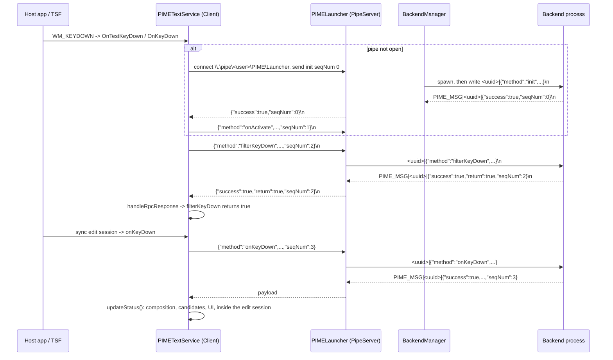

# Input request lifecycle in PIME 2.0

`docs/research/` is new in this checkout. Scope: one key event, from `PIMETextService` to a backend
process and back, verified against source; nothing here was executed on Windows.

## TL;DR

- Two framings exist: TSF → launcher is bare JSON per line; launcher → backend is
  `<client_uuid>|<json>` and backend → launcher is `PIME_MSG|<client_uuid>|<json>`.
- The launcher is a router, not a request tracker: it routes replies by `client_id` and uses
  `(client_id, seqNum)` only to detect a hung backend.
- `seqNum` is generated by the C++ client, echoed by the backend, and enforced only in C++
  (`PIMEClient.cpp:745`); a mismatch closes the pipe and resets TSF state.
- The first frame on every pipe is `init` carrying the language-profile GUID; the launcher maps it
  to a backend via `backends.json` + `ime.json`, then spawns that backend lazily.
- No idle timeout: backends are restarted 1 s after any abnormal exit, and all clients of that
  backend are disconnected. `libIME2/` holds no IPC code, only TSF framework.
- #936 and #937 are one hole in the Node backend: a pre-`init` or unknown-service request
  dereferences `null` `service`/`state`, and nothing catches the throw.

## Request path

An eaten key costs two round trips: `filterKeyDown` from the key-sink test, then `onKeyDown` inside
the synchronous edit session opened at `libIME2/src/TextService.cpp:743`.

## 1. Wire format

### TSF → launcher → TSF

| Direction | Frame | Source |
|---|---|---|
| C++ → launcher | one JSON object, no prefix, terminated `\n` | `PIMETextService/PIMEClient.cpp:697-701` |
| launcher → C++ | one JSON object, no prefix, `\n` appended by the codec | `PIMELauncher/src/client_session.rs:90-96` |

The pipe is `\\.\pipe\<username>\PIME\Launcher` on both sides
(`PIMEClient.cpp:860-872`, `PIMELauncher/src/main.rs:314`), byte-mode with up to 254 instances
(`pipe_server.rs:33-35`), so message boundaries come only from `\n`. C++ accumulates 8 KiB reads
until it sees a newline and keeps excess in `readBuffer_` (`PIMEClient.cpp:708-722`).

Every request carries `method` and `seqNum`; the counter is per-`Client`, starting at 0
(`PIMEClient.cpp:734-735`, `PIMEClient.h:118`). `init` adds `id` (lowercase GUID), `isWindows8Above`,
`isMetroApp`, `isUiLess`, `isConsole` (`PIMEClient.cpp:639-645`); key methods add `charCode`,
`keyCode`, `repeatCount`, `scanCode`, `isExtended` and a 256-element `keyStates` array
(`PIMEClient.cpp:91-103`). Replies must contain `success`; key methods also read `return`
(`PIMEClient.cpp:436-443`).

### Launcher → backend → launcher

| Direction | Frame | Source |
|---|---|---|
| launcher → backend stdin | `<client_uuid>|<json>\n` | `PIMELauncher/src/protocol.rs:44-46`, `client_session.rs:75` |
| backend stdout → launcher | `PIME_MSG|<client_uuid>|<json>\n` | `protocol.rs:35-40`, `backend_manager.rs:312` |

The `<client_uuid>` is a fresh `Uuid::new_v4()` per pipe connection, not the TSF GUID
(`pipe_server.rs:109`). The GUID appears only in the `init` payload and is used once for routing
(`pipe_server.rs:132-147`). Lines without the `PIME_MSG|` prefix are silently dropped
(`backend_manager.rs:312-314`), which is how stray prints from a backend get discarded.

### Encoding and limits

- UTF-8 throughout: `json::dump()` keeps non-ASCII (`PIMEClient.cpp:737`), Python uses
  `ensure_ascii=False` (`python/server.py:118`), and the launcher sets `PYTHONIOENCODING=utf-8:ignore`
  (`backend_manager.rs:282`).
- Rust `LinesCodec` requires valid UTF-8 and rejects lines over 1 MiB (`protocol.rs:5`,
  `pipe_server.rs:114-118`). C++ has no size cap, so an oversized reply is dropped by the launcher and
  surfaces as a read timeout. C++ strips only `\n` (`PIMEClient.cpp:712-716`); Rust never emits `\r`.

### Correlation

`seqNum` is the only correlation id. The launcher records `(client_id, seqNum)` when forwarding
(`backend_manager.rs:382-386`) and removes it when a matching reply arrives
(`backend_manager.rs:316-319`), but never rejects a mismatch: routing is by `client_id` alone
(`backend_manager.rs:322-330`). Enforcement is in C++, which nulls the response, closes the pipe and
resets TSF state on failure (`PIMEClient.cpp:745-760`).

## 2. Lifecycle

**Who spawns the backend, when.** One `BackendProcess` per backend *name*, created on demand by
`get_backend_input` when the map has no entry (`backend_manager.rs:121-136`). It is called from
`accept_client` after the GUID resolves (`pipe_server.rs:175-184`), so the backend starts on the first
handshake naming it, is shared by all its clients, and lives until it dies or the launcher exits.

Configuration comes from `<PIME root>/backends.json` (`backend_registry.rs:64-100`) plus a scan of
`input_methods/*/ime.json` for `guid` (`backend_registry.rs:102-130`). The executable is resolved
relative to the launcher (`main.rs:314-323`) and spawned with piped stdio and `kill_on_drop`
(`backend_manager.rs:273-288`).

**First request.** `Client` is constructed per language-profile activation, not at DLL load
(`PIMETextService/PIMETextService.cpp:221-222`), but the pipe opens lazily on the first RPC:
`onActivate` triggers `waitForRpcConnection` (3 × 3000 ms), sends `init`, then `onActivate` only if
`init` succeeded (`PIMEClient.cpp:797-824`). `shouldWaitConnection_` is cleared during `init` to
avoid recursion (`PIMEClient.cpp:812-818`). The launcher forwards the handshake unchanged, prefixing
the new UUID (`pipe_server.rs:195-200`).

**Idle timeout / restart.** None for idleness. Timeouts that do exist:

| Timeout | Value | Where |
|---|---|---|
| C++ RPC read/write | 2 s, except 15 s for `init`/`onActivate` | `PIMEClient.h:81-82`, `PIMEClient.cpp:639-650`, `413-421` |
| launcher write to backend stdin | 5 s → kill + restart | `protocol.rs:11`, `backend_manager.rs:395-400` |
| launcher hang watchdog | 15 s per pending request → kill + restart | `protocol.rs:8`, `backend_manager.rs:408-420` |
| slow client drain | 500 ms → drop that client | `backend_manager.rs:330-339` |
| pipe connect | 3 × 3 s on the calling thread | `PIMEClient.cpp:806-808` (issue #942) |

On abnormal exit (`child_process.wait()`, write failure, watchdog) the loop kills, calls
`disconnect_clients_for_backend`, sleeps 1 s and respawns (`backend_manager.rs:219-232`, `107-118`).
`BackendExitReason::Normal` — stdin channel closed, i.e. launcher shutdown — breaks the loop instead
of restarting (`backend_manager.rs:373-380`). A separate watchdog process respawns the launcher
worker itself (`main.rs:34-105`).

**How the reply reaches TSF.** `forward_outputs_to_client` parses the prefix and sends the bare
payload to the session's mpsc channel (`backend_manager.rs:293-338`); the session writes it to the
pipe (`client_session.rs:90-96`); C++ parses one line (`PIMEClient.cpp:741-750`), `handleRpcResponse`
checks `success`, and `updateStatus` applies composition, candidates, UI and preserved keys inside
the edit session (`PIMEClient.cpp:105-115`, `337-353`). On disconnect the launcher synthesises
`{"method":"close","seqNum":last+1}` for the backend (`backend_manager.rs:91-105`).

## 3. Backend init contract

A backend must answer **every** line, including the first `init`, with exactly one
`PIME_MSG|<uuid>|<json>` line echoing `seqNum` and carrying `success`. Silence, a missing or
mismatched `seqNum` is indistinguishable from a broken pipe in C++ and costs the session
(`PIMEClient.cpp:745-760`). `success:false` is legal: C++ passes the key through.

Behaviour before `init` and for unknown ids differs per backend:

- **Python** — a `Client` per `client_id`; requests before service creation return
  `{"seqNum": n, "success": false}` (`python/server.py:59-72`). `init` resolves the GUID through
  `createService`, returning `None` for unknown GUIDs, so `success` stays false on every request
  (`python/serviceManager.py:84-89`). A per-line `except` replies `{"success": false, "seqNum": n}`
  and continues (`python/server.py:123-140`) — the behaviour #936 asks Node to copy.
- **Node / nime** — `init` for an unknown GUID returns `{"success": false, "seqNum": n}` and stores
  `{service: null, state: {}}` (`requestHandler.js:35-38`, `nimeServer.js:29`); a non-`init` line for
  an unseen client stores `{service: null, state: null}` (`nimeServer.js:75-78`). Either way the next
  request reaches `handleRequest(request, {state, service = textService})`, the default does not fire
  for explicit `null`, and `service.textReducer` throws (`requestHandler.js:43-51`). Nothing catches
  it: the #937 mechanism and the #936 crash.
- **Go** — `init` is handled explicitly: missing/unknown GUID, failing `Service.Init`, uninitialised
  client and unknown method all return `success:false` with `error` (`go-backend/server.go:169-290`).
  But `Run`'s error path emits `{"success": false, "error": …}` without `seqNum`
  (`go-backend/server.go:133-150`), which C++ treats as a protocol failure and answers by closing the
  pipe. `pime/server.go:120-127` is a second, unused server that tests `Method == ""` and would
  answer a real `init` with `success:true`.

**Unknown service id at the launcher.** Resolution failure closes the connection with no reply
(`pipe_server.rs:139-147`); C++ sees EOF or times out, calls `closeRpcConnection` and
`resetTextServiceState` (`PIMEClient.cpp:754-760`), and retries on the next keystroke. The backend
never learns a client was refused.

**Backend throws or exits.** Python survives (above); Node does not; Go logs and, when possible,
emits `success:false`. An exit ends stdout and `forward_inputs_to_backend` returns
`BackendExitReason::Error` (`backend_manager.rs:424-426`); clients are disconnected and the process
respawns after 1 s, so the next request reconnects, re-`init`s and re-sends `onActivate`
(`PIMEClient.cpp:820-825`).

## 4. Issue anchors

| Issue | Location that would change |
|---|---|
| #936 Node: uncaught exception kills backend | `node/server.js:34` (bootstrap ends at `server.listen()`; no `process.on('uncaughtException')`) |
| #937 Node: pre-init / unknown service crash | `node/server.js:31` (`return service`, may be `null`; dereferenced at `requestHandler.js:51`) |
| #938 surrogate-pair cursor misalignment | `PIMETextService/PIMEClient.cpp:239` |
| #939 candidate font name not NUL-terminated | `PIMETextService/PIMETextService.cpp:258` |
| #940 `ImeModule` constructed under loader lock | `PIMETextService/DllEntry.cpp:23` |
| #941 shared static icon cache | `PIMETextService/PIMELangBarButton.h:57` |
| #942 UI-thread freeze on connect | `PIMETextService/PIMEClient.cpp:808` (3 × 3000 ms loop at `:806`) |
| #943 stale queue replayed after restart | `PIMELauncher/src/backend_manager.rs:231` (disconnect + 1 s sleep before respawn) |

## Open questions

- Why does the launcher not validate `seqNum` on the way back, given that it already stores
  `(client_id, seqNum)` (`backend_manager.rs:316-319`)? A mis-echoing backend is caught only in C++.
- Is the branch at `backend_manager.rs:340-348` reachable? It looks for `"method":"close"` in a
  *reply*, but Python and Node reply `{"success":true,"seqNum":n}` with no `method`
  (`python/server.py:111-114`, `nimeServer.js:82-87`), so those lines log as "unknown client".
- `readBuffer_` persists across calls (`PIMEClient.cpp:712-716`); an unsolicited backend line would
  be consumed as the next reply. No push channel exists today, so this is latent.
- C++ `init` timeout and the hang watchdog are both 15 s (`PIMEClient.h:82`, `protocol.rs:8`).

## Not verifiable here

- Any execution of `PIMETextService`, `libIME2` or `PIMELauncher`: this host has no Visual Studio
  toolchain, so those targets cannot be built or run here
  (`docs/agents/verification.md`). Read instead: `PIMEClient.cpp/.h`,
  `PIMETextService.cpp`, all of `PIMELauncher/src`, `node/server.js`, `node/node_modules/nime/src`,
  `python/`, `go-backend/`.
- Real named-pipe semantics (byte vs message mode, `WaitNamedPipe` timing, ACLs) and TSF callback
  threading. Byte mode rests on `pipe_server.rs:35`; C++ passes `FILE_FLAG_OVERLAPPED` and no
  message-mode flag (`PIMEClient.cpp:780`). Whether each backend emits UTF-8 in the field is intent
  only: Node uses its default stream encoding, Go `encoding/json`, Python the environment variable.
- The brief's claim that `libIME2/` holds the protocol header is false for commit `6446eed`;
  `libIME2/src` has only TSF framework files and no IPC or JSON references.
